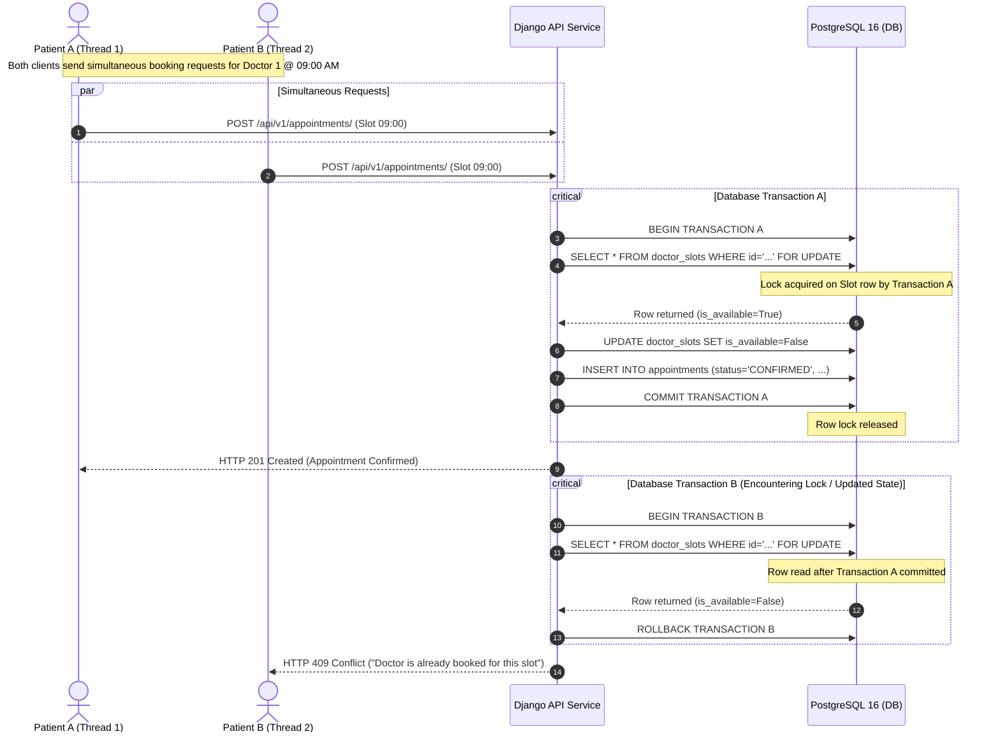
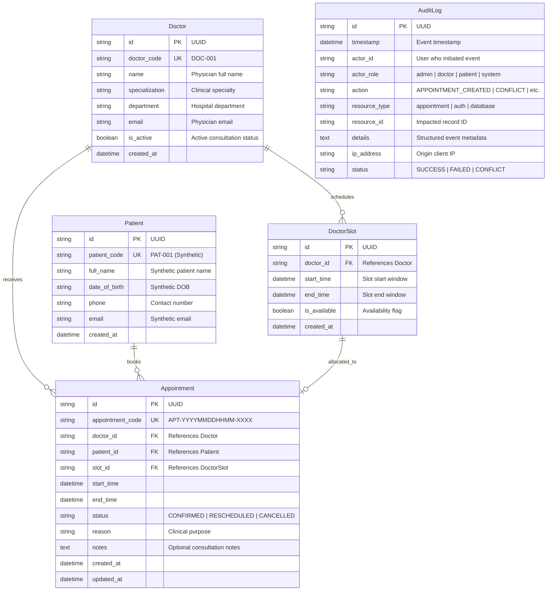

# Architecture Specification - Hospital Management Platform
**DevOps & Cloud Engineering Assessment Package**

---

## 1. System Architecture Overview

The Hospital Management Platform is architected as an isolated, containerized, three-tier microservice designed for deterministic reproducibility, high availability, and zero data corruption under concurrent traffic.

```mermaid
flowchart TD
    Client["Client / Browser / Test Suite"]
    
    subgraph DMZ ["Front-Facing Network (proxy-net)"]
        Nginx["Nginx Reverse Proxy\n(Port 80/443)\n• SSL/TLS 1.3 Termination\n• Strict Port 80 -> 443 Redirect\n• IP Rate Limiting (20 req/s)\n• Security Headers (HSTS, CSP)"]
    end

    subgraph AppTier ["Application Tier (proxy-net & internal-net)"]
        Gunicorn["Gunicorn WSGI / Python 3.10\n(Non-Root User: appuser, UID 10001)"]
        FastAPI["Django REST Framework\n• JWT Bearer Auth & RBAC\n• Input Validation (Serializers)\n• Atomic Row Locking (select_for_update)\n• Structured JSON Logging\n• Prometheus Metrics (/metrics/)"]
    end

    subgraph DataTier ["Isolated Persistence Tier (internal-net)"]
        Postgres[("PostgreSQL 16 Alpine\n• ACID Isolation\n• Row-Level Write Locks\n• Persistent Volume (postgres_data)\n• Automated Backup / Restore")]
    end

    Client -->|HTTPS Port 443| Nginx
    Client -.->|HTTP Port 80 (Redirect 301)| Nginx
    Nginx -->|HTTP Reverse Proxy| Gunicorn
    Gunicorn --> FastAPI
    FastAPI -->|TCP Port 5432 (Internal Only)| Postgres
```

---

## 2. Network Topology & Security Boundaries

The infrastructure enforces strict **Least Privilege** network segmentation using Docker bridge networks:

1. **`proxy-net` (External Ingress)**:
   * Bridges the Nginx reverse proxy and the application container.
   * Public ports `80` and `443` are exposed on the host.
   * Direct access to the application API port (`8000`) is blocked from the host; all traffic must traverse Nginx.

2. **`internal-net` (Data Isolation)**:
   * Marked `internal: true` in Docker Compose.
   * Connects the Django API container to the PostgreSQL database.
   * **PostgreSQL port `5432` is not bound to the host**. Database connections cannot be initiated from outside the container network, eliminating external port-scanning attack vectors.

---

## 3. Concurrency Control & Double Booking Prevention

The core domain rule states:
> *"Two conflicting appointment requests must not both succeed; prevent two confirmed appointments for the same doctor/time slot, including concurrent requests."*

### Race Condition Mitigation Sequence



---

## 4. Entity-Relationship Data Model



---

## 5. CI/CD Pipeline Architecture

```mermaid
flowchart LR
    subgraph Stage1 ["Stage 1: Lint & Security"]
        A[Git Push / PR] --> B[Black Style Check]
        B --> C[Flake8 Linting]
        C --> D[Bandit Static Security Scan]
    end

    subgraph Stage2 ["Stage 2: Test & Concurrency"]
        D --> E[Pytest Unit Tests]
        E --> F[Pytest Integration Tests]
        F --> G[10-Thread Concurrency Test]
        G --> H[Code Coverage Report]
    end

    subgraph Stage3 ["Stage 3: Build & Vulnerability Scan"]
        H --> I[Docker Multi-Stage Build]
        I --> J[Trivy Container Scan]
        J --> K[Version Tagging: SHA & latest]
    end

    subgraph Stage4 ["Stage 4: Smoke Test"]
        K --> L[Docker Compose Up]
        L --> M[Readiness Probe /health/readiness/]
        M --> N[Clean Compose Teardown]
    end
```



---

## 6. Security Posture & Defense in Depth

1. **Non-Root Container Execution**: The Docker container executes as `appuser` (UID 10001, GID 10001). Even in the event of an application vulnerability, the container process cannot acquire host root privileges.
2. **Minimal Attack Surface**: The production image uses Debian Bookworm Slim, shedding development toolchains (`gcc`, build headers) after wheel compilation.
3. **Transport Layer Hardening**: Nginx terminates TLS with modern cipher suites (`TLSv1.2`, `TLSv1.3`), enforces HTTP Strict Transport Security (`HSTS`), and applies `X-Frame-Options: DENY`, `X-Content-Type-Options: nosniff`, and `X-XSS-Protection`.
4. **Synthetic Data Quarantine**: No real patient data is permitted or processed in accordance with HIPAA / GDPR compliance guidelines. Seed scripts populate only synthetic clinical profiles.
5. **Secret Hygiene**: Zero credentials or private keys are committed into Git. All sensitive parameters are resolved through environment variables with `.env.example` placeholders.
